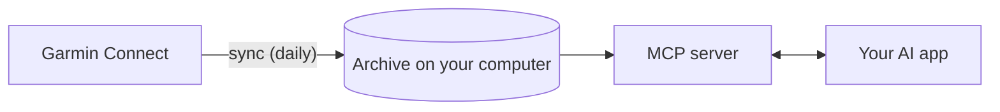

# garmin-connect-personal-mcp

**Ask your AI assistant about your own Garmin data: your sleep, recovery, training and workouts. Your data stays on your computer.**

Your Garmin watch records years of useful signals: sleep stages, resting heart rate, HRV, stress, Body Battery, every run and ride. The Garmin Connect app shows them one chart at a time, which makes it hard to answer simple questions like "why do I feel so flat this week?" This project lets Claude, ChatGPT, Gemini or any other assistant that supports MCP read them all together, so you can just ask:

> **You:** I've felt flat this week. Is anything off?
>
> **Assistant:** Your resting heart rate has been 58–61 bpm since Tuesday, against your usual 51–53, and your overnight HRV dropped from about 60 ms to 46 ms. Your sleep score fell too. That pattern often shows up when you're run down or fighting something off, so an easy few days could help. If it doesn't settle, it's worth checking with a doctor.

*(An example with made-up numbers.)*

> **Unofficial.** Not affiliated with, endorsed by or supported by Garmin. Garmin and Garmin Connect are trademarks of Garmin Ltd. or its subsidiaries.
>
> **Not medical advice.** The data comes from a consumer wearable. The tools report numbers and trends; they don't diagnose anything.

## Why it's built this way

- **Private by design.** You run it on your own computer with your own Garmin key. There's no hosted service, no account to create, and nothing passes through this project. Your name, photos and GPS routes are never handed to the assistant.
- **Your history, kept.** How far back Garmin's API reaches isn't guaranteed. A daily sync builds a local archive of everything it has fetched, so you can still ask about this year next year.
- **Honest about gaps.** A night you didn't wear the watch shows up as missing, never as zero, so the assistant doesn't draw conclusions from data that isn't there.
- **Works with the assistant you already use.** It uses the open [Model Context Protocol](https://modelcontextprotocol.io/), with one-command setup for the popular apps.
- **Built on Garmin's official API.** It uses Garmin's own Personal API and Python client: no screen scraping, and it never asks for your password.

## How it works



1. **Sync** downloads your data from Garmin's Personal API into a SQLite archive in your user folder, once a day if you like.
2. **The MCP server** gives your AI app a set of read-only tools over that archive.
3. **Your AI app** calls those tools when you ask a question, and answers from what they return.

Only syncing talks to Garmin. Answering a question happens on your computer, apart from the results your AI app sends to its own provider, as with anything you ask it.

## Get started

You need a Garmin device that syncs to Garmin Connect, and [uv](https://docs.astral.sh/uv/getting-started/installation/) to install it (uv takes care of Python for you). Setup takes about five minutes.

1. **Install it:**

   ```bash
   uv tool install garmin-connect-personal-mcp
   ```

2. **Save your Garmin key.** Create a Personal API key in [Garmin Connect's settings](https://connect.garmin.com/app/settings/personalApiToken), then paste it at the hidden prompt:

   ```bash
   garmin-connect-personal-mcp init
   ```

3. **Download your data.** This fetches the last 90 days; later runs pick up where they left off:

   ```bash
   garmin-connect-personal-mcp sync --days-back 90
   ```

4. **Keep it up to date** (recommended). This adds a daily sync to your computer's scheduler, which is how your history builds up:

   ```bash
   garmin-connect-personal-mcp schedule install
   ```

5. **Connect your AI app.** Leave out `--write` to see the change first:

   | App | Command |
   | --- | --- |
   | Claude Desktop | `garmin-connect-personal-mcp install-client claude-desktop --write` |
   | Claude Code | `garmin-connect-personal-mcp install-client claude-code --write` |
   | Cursor | `garmin-connect-personal-mcp install-client cursor --write` |
   | VS Code | `garmin-connect-personal-mcp install-client vscode` |
   | Gemini CLI | `garmin-connect-personal-mcp install-client gemini --write` |
   | Codex CLI | `garmin-connect-personal-mcp install-client codex --write` |
   | ChatGPT | `garmin-connect-personal-mcp setup-chatgpt` |

   Each app has a [setup guide](docs/clients/README.md). ChatGPT connects through OpenAI's private Secure MCP Tunnel, and its [guide](docs/clients/chatgpt.md) walks you through the account setup.

6. **Restart the app and ask:** *"How did I sleep last night?"*

To update later, run `uv tool upgrade garmin-connect-personal-mcp`.

### Want to try it first?

You don't need a Garmin account to look around. The `demo` command writes four months of made-up data into a new folder, with a training block, a few sick days and some nights the watch stayed on the charger, so there's plenty to ask about:

```bash
garmin-connect-personal-mcp demo ~/garmin-demo
GARMIN_MCP_DATA_DIR=~/garmin-demo garmin-connect-personal-mcp install-client claude-desktop --write
```

The demo never touches a real archive, and sync is switched off for it. Run `install-client` again without `GARMIN_MCP_DATA_DIR` to switch back.

## What you can ask

**Daily health**
- "How did I sleep last night? Was that normal for me?"
- "Is my resting heart rate lower than three months ago?"
- "Anything unusual in my HRV lately?"

**Training and workouts**
- "Summarize my training and recovery this week."
- "How has my weekly running distance built up since July?"
- "Did my heart rate drift in the second half of yesterday's run?"

**Comparisons and patterns**
- "Did I sleep more in October than in September?"
- "Do I sleep better on days I run?"
- "Show me my sleep for the last two weeks." Apps that support [MCP Apps](https://modelcontextprotocol.io/) (Claude Desktop, claude.ai, ChatGPT, VS Code) show an interactive chart; other apps describe the same numbers in words.

## The tools

Your AI app picks these on its own, so you never need to name them. They're here if you're curious.

| Tool | What it answers |
| --- | --- |
| `garmin_describe_data` | What's in your archive: dates covered, metrics and units |
| `garmin_get_day` | Sleep, HRV and daily totals for one day, plus its workouts |
| `garmin_get_trend` | One metric over time, per day or per week |
| `garmin_get_baseline` | How a day compares with your own usual range |
| `garmin_compare_periods` | One metric across two date ranges, side by side |
| `garmin_list_activities` | Your workouts, newest first, filtered by date and sport |
| `garmin_get_activity` | One workout in detail: heart-rate zones, power, splits |
| `garmin_get_activity_stream` | One workout over time: heart rate, pace, cadence, power, altitude |
| `garmin_query` | Read-only SQL for anything the others can't answer |
| `garmin_show_chart` | An interactive chart of a metric |
| `garmin_sync` | Fetch the latest data from Garmin |

[docs/tools.md](docs/tools.md) has every argument, and [docs/data.md](docs/data.md) lists every metric with its unit.

## Privacy and security

- **Everything stays on your computer:** your archive, in your user data folder, and your Garmin key.
- **The only network requests go to Garmin**, to sync. `--read-only` takes syncing away from the AI app altogether.
- **Your AI app's provider sees what the tools return** when you ask a question, as with anything you type. The tools never include your name, profile photos or GPS coordinates, even though Garmin's records contain them, and the SQL tool reads a cleaned copy without them.
- **Nothing is written back to Garmin.** Its Personal API is read-only.

If you find a security problem, please report it privately, as described in [SECURITY.md](SECURITY.md).

## Stability

From 1.0, updates only add things. Tool names, their arguments and output fields, metric names and units, and the query tables stay put until 2.0, so your prompts, scripts and saved setups keep working. A test checks the tools, metrics and query tables on every change; see [Stability in CONTRIBUTING.md](CONTRIBUTING.md#stability). The [changelog](CHANGELOG.md) lists what's new in each release.

## Getting help

- **Something's wrong?** Run `garmin-connect-personal-mcp doctor`. It checks your key, Garmin access, the archive and the daily sync, and tells you how to fix anything it finds. Its report leaves out anything personal, so it's safe to paste into an issue.
- **[Troubleshooting](docs/troubleshooting.md)** goes through common problems by symptom.
- **[FAQ](docs/faq.md)**: which devices work, how far back your history goes, rate limits, units, uninstalling.
- **[Report a bug or suggest a feature](https://github.com/braydenabo/garmin-mcp/issues/new/choose).**

## Contributing

Bug reports, ideas and pull requests are all welcome. [CONTRIBUTING.md](CONTRIBUTING.md) covers setup, tests and pull requests, and [AGENTS.md](AGENTS.md) has the rules for AI coding agents. One rule above all: this is health data in a public repository, so tests use made-up data only, and real keys or health data never go in issues or commits.

```bash
uv sync
uv run pre-commit install
uv run pytest
```

## License

[Apache-2.0](LICENSE)
